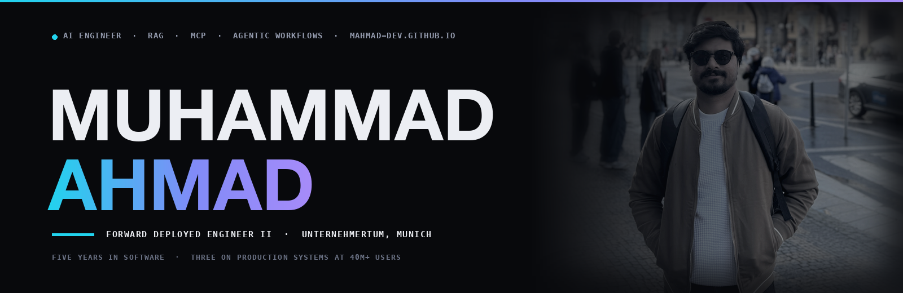

  

  
  
  
  

---

### AI engineer building retrieval systems, MCP gateways and agentic workflows that hold up in production.

**Forward Deployed Engineer II** at **UnternehmerTUM's Venture Lab** in Munich, taking AI use cases from concept to deployed internal product on multi-day cycles. Before that, three years at **Dubizzle Labs** on the backends behind Zameen.com, Bayut.sa and Propforce (40M+ monthly users), and the AI layer I built on top of them. Five years shipping software, now from Germany. M.Sc. candidate at TU Ilmenau.

---

### 📌 Selected work

Most of this ran inside company infrastructure, so the repository is not the artifact. Every row links to something you can actually check.

| System | What it does | Evidence |
| :--- | :--- | :--- |
| 🛡️ **[rag-integrity-guard](https://github.com/mahmad-dev/rag-integrity-guard)** `open source` | Fingerprints every RAG chunk at ingestion and re-verifies it at query time, catching a poisoned or tampered chunk before it reaches the model | [MIT source](https://github.com/mahmad-dev/rag-integrity-guard) · [benchmark report](https://github.com/mahmad-dev/rag-integrity-guard/blob/main/apps/api/data/benchmark_report.json) |
| 📞 **Zara AI calling workflow** `Dubizzle Labs` | Campaign orchestration for an AI voice agent: callbacks, follow-ups, task creation and WhatsApp follow-through across two CRMs, with an on/off switch the business team operates without a deploy | [case study](https://muhammadahmad.de/project-zara-calling.html) · [manager's reference](https://muhammadahmad.de/#rec-zeeshan) |
| 🤖 **AVA copilot** `Dubizzle Labs` | A chat request becomes clarified requirements, LLM-drafted wireframes, a filed Jira ticket, and a branch opened as a pull request under human review | [case study](https://muhammadahmad.de/project-sdlc.html) · [manager's reference](https://muhammadahmad.de/#rec-zeeshan) |
| 🔌 **MCP gateway** `Dubizzle Labs` | Internal microservice APIs exposed to LLM agents as typed, permissioned tools, with dynamic schema generation, per-caller rate limiting and full invocation logging | [case study](https://muhammadahmad.de/project-mcp.html) · [manager's reference](https://muhammadahmad.de/#rec-zeeshan) |
| 🧭 **[Career OS](https://germany-career-os.vercel.app/)** `live` | Three parallel job searches from one evidence-backed profile, pairing a deterministic 11-factor scorer with a fabrication-guarded LLM second opinion | [live app](https://germany-career-os.vercel.app/) · [case study](https://muhammadahmad.de/project-career-os.html) |
| 💬 **[Ask Ahmad](https://ask.muhammadahmad.de)** `live` | A retrieval-grounded twin that answers only from published material and refuses when no source supports an answer | [ask it yourself](https://ask.muhammadahmad.de) |

> Nothing above is claimed without a link. If a row had no evidence, it is not in the table.

### 🔬 Research

**Data-integrity layer for LangChain QnA systems**, with two PhD researchers at the University of Verona. Blockchain-anchored Merkle fingerprints over a retrieval corpus, re-verified at inference time, so tampering with source documents is caught before a poisoned answer is served. *Paper in progress.*

---

### 🧰 Tech Stack

**AI / LLM**

  
  
  
  
  

**Backend & Web**

  
  
  
  
  
  

**Data & Infra**

  
  
  
  
  
  
  
  

**Also worked with**

  
  
  
  

---

### 🎯 Currently

- 🇩🇪 Open to **full-time AI & backend engineering roles**, Germany or remote. EU Blue Card eligible
- 🎓 **M.Sc. Computer & System Engineering**, TU Ilmenau
- 📫 [LinkedIn](https://www.linkedin.com/in/mahmad12/) · [Portfolio](https://muhammadahmad.de/) · [ahmad.arshad7869@gmail.com](mailto:ahmad.arshad7869@gmail.com)

---

Building an AI system that has to survive production? Write to me.

